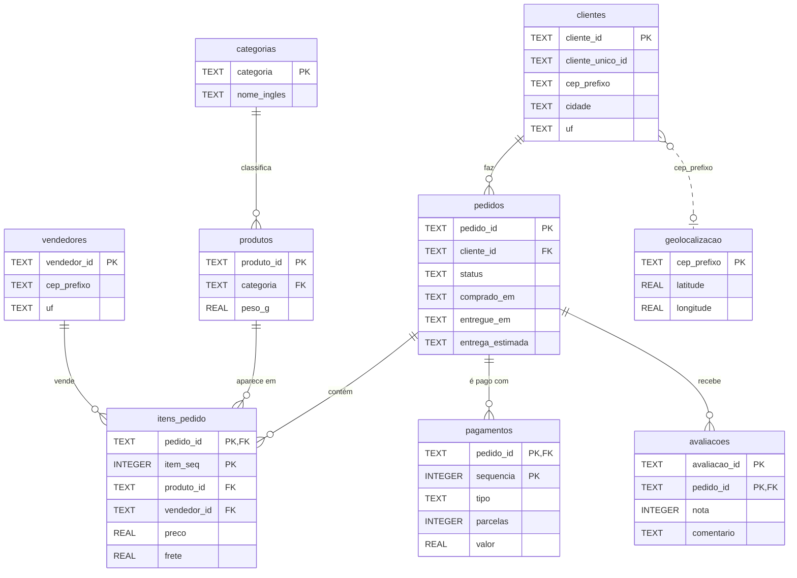

# Análise de e-commerce com SQL | Olist

Banco de dados relacional construído a partir de 1,5 milhão de linhas de dados públicos da Olist, um marketplace brasileiro que conecta pequenos lojistas aos grandes canais de venda on-line. Todo o trabalho com os dados é feito em SQL: carga em staging, modelagem, transformação, validação de qualidade e consultas analíticas que respondem perguntas de negócio.

## O que este projeto mostra

- **Modelagem relacional:** 9 tabelas com chaves primárias e estrangeiras, restrições `CHECK` e índices.
- **ETL em SQL:** os CSVs entram em tabelas de staging e são tipados, padronizados e deduplicados até o modelo final.
- **Qualidade de dados:** 12 verificações automáticas, cada uma com o tratamento aplicado.
- **SQL analítico:** `JOIN`, CTEs, view, `CASE` e window functions (`LAG`, `RANK`, `ROW_NUMBER`, soma acumulada e janela nomeada).
- **Power BI:** modelo dimensional (esquema estrela) exportado para um dashboard com medidas DAX. Veja [`powerbi/`](powerbi/).

## Principais resultados

- **O atraso derruba a avaliação.** Pedidos entregues no prazo têm nota média acima de 4,2. Com 4 a 7 dias de atraso, a média cai para 2,1, e acima de 8 dias cerca de 80% das notas são 1 ou 2.
- **Quase ninguém volta a comprar.** 97% dos clientes fizeram um único pedido no período.
- **O faturamento é concentrado.** 540 dos 3.053 vendedores (17,7%) respondem por 80% do faturamento.
- **Norte e Nordeste esperam mais e pagam mais frete.** O prazo médio em Roraima é de 29,4 dias, contra 12,0 em Minas Gerais. Lá o frete equivale a 28,5% do valor dos produtos; no Rio de Janeiro e no Distrito Federal, a 16,8%.
- **Novembro de 2017 foi o pico.** O faturamento cresceu 52,1% em relação a outubro, no mês da Black Friday.

Todas as tabelas de resultado estão em [`resultados/RESULTADOS.md`](resultados/RESULTADOS.md).

## Modelo de dados



A view `vw_pedidos` reúne em uma linha por pedido o cliente, os valores, o prazo de entrega, o atraso e a nota, e é a base de várias consultas.

## Como os dados passam pelo banco

| Etapa | Arquivo | O que acontece |
| --- | --- | --- |
| 1 | [`sql/01_staging.sql`](sql/01_staging.sql) | Tabelas de staging recebem os CSVs como texto, sem alterações |
| 2 | [`sql/02_modelo.sql`](sql/02_modelo.sql) | Criação do modelo com chaves, restrições e índices |
| 3 | [`sql/03_transformacao.sql`](sql/03_transformacao.sql) | Tipagem, padronização e carga no modelo final |
| 4 | [`sql/04_views.sql`](sql/04_views.sql) | View analítica com uma linha por pedido |
| 5 | [`sql/05_qualidade.sql`](sql/05_qualidade.sql) | Relatório de qualidade gravado na tabela `relatorio_qualidade` |
| 6 | [`consultas/`](consultas/) | Consultas de negócio, com resultado salvo em `resultados/` |
| 7 | [`sql/07_modelo_dimensional.sql`](sql/07_modelo_dimensional.sql) | Fatos e dimensões exportados em CSV para o Power BI |
| 8 | [`sql/06_limpeza.sql`](sql/06_limpeza.sql) | Remoção das tabelas de staging, que não são mais necessárias |

O script [`executar.py`](executar.py) roda as etapas em ordem e confere a integridade referencial com `PRAGMA foreign_key_check`.

## Qualidade dos dados

Alguns dos problemas encontrados e como foram tratados:

| Problema | Ocorrências | Tratamento |
| --- | --- | --- |
| Linhas repetidas na base de geolocalização | 261.831 | Agregação em uma linha por prefixo de CEP |
| Prefixos de CEP com mais de uma grafia de cidade | 8.555 | Mantida a grafia mais frequente, escolhida com `ROW_NUMBER` |
| Mesmo `review_id` usado em mais de um pedido | 802 | Chave primária composta (`avaliacao_id`, `pedido_id`) |
| Pedidos com status entregue e sem data de entrega | 8 | Fora das análises de prazo |
| Coordenadas fora do território brasileiro | 42 | Descartadas no cálculo da coordenada média |

O relatório completo, com as 12 verificações, está em [`resultados/RESULTADOS.md`](resultados/RESULTADOS.md).

## Consultas

| Consulta | Pergunta | Técnicas |
| --- | --- | --- |
| [`01`](consultas/01_visao_geral.sql) | Qual é o tamanho da operação no período? | Agregação sobre view |
| [`02`](consultas/02_faturamento_mensal.sql) | Como o faturamento evoluiu mês a mês? | CTE, `LAG`, janela nomeada |
| [`03`](consultas/03_categorias_mais_vendidas.sql) | Quais categorias concentram o faturamento? | `JOIN`, participação e soma acumulada com window function |
| [`04`](consultas/04_prazo_de_entrega_por_uf.sql) | Em quais estados a entrega demora mais e atrasa mais? | Cálculo de datas com `julianday` |
| [`05`](consultas/05_atraso_e_avaliacao.sql) | O atraso na entrega derruba a nota do cliente? | Faixas com `CASE` |
| [`06`](consultas/06_recompra.sql) | Quantos clientes voltam a comprar? | Window function sobre agregação |
| [`07`](consultas/07_top_vendedores_por_uf.sql) | Quem são os 3 maiores vendedores de cada estado? | `RANK` com `PARTITION BY` |
| [`08`](consultas/08_concentracao_de_vendedores.sql) | Quantos vendedores respondem pela maior parte do faturamento? | `ROW_NUMBER` e soma acumulada (Pareto) |
| [`09`](consultas/09_formas_de_pagamento.sql) | Como os clientes pagam? | Subconsulta escalar |
| [`10`](consultas/10_peso_do_frete_por_uf.sql) | Quanto o frete pesa no valor da compra em cada estado? | Razão entre agregados |

Os resultados foram conferidos de forma independente com pandas.

## Como executar

Requisitos: Python 3.9 ou superior. Não há bibliotecas para instalar, porque o projeto usa o `sqlite3` que já vem com o Python.

1. Baixe a base no Kaggle: [Brazilian E-Commerce Public Dataset by Olist](https://www.kaggle.com/datasets/olistbr/brazilian-ecommerce).
2. Extraia os arquivos `.csv` na pasta `dados/`.
3. Rode:

```bash
python executar.py
```

Em cerca de 30 segundos o script cria o banco `olist.db`, atualiza a pasta `resultados/` e gera os CSVs do Power BI em `powerbi/dados/`. O banco pode ser aberto no DBeaver ou em qualquer cliente SQLite para explorar as tabelas.

## Estrutura

```
├── consultas/       consultas de negócio
├── dados/           CSVs da Olist (não versionados)
├── powerbi/         modelo, medidas DAX, tema e roteiro do dashboard
├── resultados/      resultado de cada consulta em CSV e relatório em Markdown
├── sql/             staging, modelo, transformação, view e qualidade
└── executar.py      executa todas as etapas
```

## Fonte dos dados

[Brazilian E-Commerce Public Dataset by Olist](https://www.kaggle.com/datasets/olistbr/brazilian-ecommerce), publicado pela Olist sob a licença [CC BY-NC-SA 4.0](https://creativecommons.org/licenses/by-nc-sa/4.0/). Os dados são reais e foram anonimizados pela própria Olist; os nomes de lojas e parceiros foram substituídos.

---

Feito por **João Vitor Queiroz** · [Portfólio](https://jaumvlqueiroz.github.io) · [LinkedIn](https://www.linkedin.com/in/joaovlqueiroz/)
