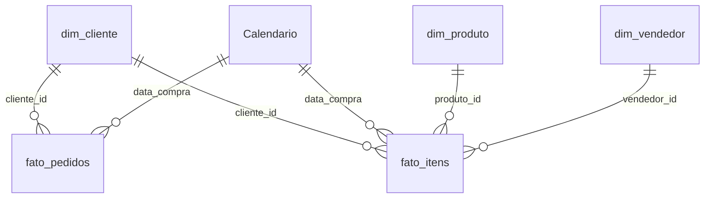

# Dashboard em Power BI

Esta pasta transforma o banco da Olist em um dashboard no Power BI. O SQL monta um modelo dimensional (esquema estrela), o `executar.py` exporta as tabelas em CSV e o dashboard responde três perguntas de negócio, cada uma com uma recomendação.

| Arquivo | Conteúdo |
| --- | --- |
| [`../sql/07_modelo_dimensional.sql`](../sql/07_modelo_dimensional.sql) | Views de fatos e dimensões |
| `dados/` | CSVs gerados pelo `executar.py` (não versionados) |
| [`calendario.dax`](calendario.dax) | Tabela de calendário |
| [`medidas.dax`](medidas.dax) | Medidas DAX |
| [`tema.json`](tema.json) | Cores e fontes do relatório |

## Modelo



- **fato_itens:** uma linha por item vendido. Base do faturamento, das categorias e dos vendedores.
- **fato_pedidos:** uma linha por pedido. Base do prazo de entrega, do atraso e da nota.
- **Clientes e recompra** são calculados a partir de `fato_itens`, para responderem também ao filtro de categoria.
- **Dimensões:** cliente e vendedor (com estado e região), produto (com categoria) e calendário.

Pedidos cancelados ou indisponíveis ficam fora das duas tabelas fato, como nas consultas em SQL.

## Passo a passo

### 1. Gerar os CSVs

Com os arquivos da Olist em `dados/`, rode na raiz do projeto:

```bash
python executar.py
```

A última etapa cria a pasta `powerbi/dados/` com cinco arquivos: `fato_pedidos`, `fato_itens`, `dim_cliente`, `dim_vendedor` e `dim_produto`.

### 2. Importar no Power BI Desktop

1. **Obter dados → Texto/CSV** e escolha `fato_pedidos.csv`.
2. Confira **Origem do arquivo: 65001: Unicode (UTF-8)** e **Delimitador: Ponto e vírgula**, e clique em **Transformar dados**.
3. Repita para os outros quatro arquivos.
4. No Power Query, confira os tipos:
   - `data_compra`: **Data**
   - `preco`, `frete`, `valor_produtos`, `valor_frete`, `dias_entrega`, `nota`: **Número decimal**
   - `entregue`, `atrasado`, `dias_atraso`, `qtd_itens`, `ordem_faixa_atraso`: **Número inteiro**
   - os campos com `_id`: **Texto**
5. Clique em **Fechar e aplicar**.

Os números usam vírgula decimal. Se os valores aparecerem multiplicados por 100 ou 1.000, vá em **Arquivo → Opções e configurações → Opções → Configurações regionais** (em "Arquivo atual"), escolha **Português (Brasil)** e atualize os dados.

### 3. Criar o calendário e os relacionamentos

1. **Modelagem → Nova tabela** e cole o conteúdo de [`calendario.dax`](calendario.dax).
2. Selecione a tabela `Calendario` e use **Marcar como tabela de datas**, com a coluna `Date`.
3. Na coluna `Mês/ano`, use **Classificar por coluna → Ano e mês**.
4. Na coluna `faixa_atraso` de `fato_pedidos`, use **Classificar por coluna → ordem_faixa_atraso**.
5. Na exibição de **Modelo**, confira ou crie os relacionamentos, todos de muitos para um e com filtro em direção única:

| De | Para |
| --- | --- |
| `fato_pedidos[cliente_id]` | `dim_cliente[cliente_id]` |
| `fato_itens[cliente_id]` | `dim_cliente[cliente_id]` |
| `fato_itens[produto_id]` | `dim_produto[produto_id]` |
| `fato_itens[vendedor_id]` | `dim_vendedor[vendedor_id]` |
| `fato_pedidos[data_compra]` | `Calendario[Date]` |
| `fato_itens[data_compra]` | `Calendario[Date]` |

### 4. Criar as medidas

Crie uma tabela vazia chamada `Medidas` (**Página Inicial → Inserir dados → Carregar**) para guardar as medidas em um só lugar. Depois, para cada medida de [`medidas.dax`](medidas.dax), use **Nova medida** e cole o texto.

Se o Power BI acusar erro de sintaxe, troque as vírgulas que separam os argumentos por ponto e vírgula. Isso depende da configuração **Separadores DAX** em Opções → Configurações regionais.

Formatos: `Faturamento`, `Faturamento mês anterior`, `Faturamento acumulado no ano`, `Frete` e `Ticket médio` em moeda (R$); `Frete sobre produtos`, `Variação mensal`, `Pedidos atrasados`, `Notas 1 e 2`, `Clientes com recompra` e `Parcela dos vendedores para 80%` em porcentagem com uma casa; `Nota média` e `Prazo médio (dias)` com uma casa decimal.

### 5. Conferir os números

Antes de montar as páginas, coloque cada medida em um cartão e compare com os valores abaixo, que vêm das consultas em SQL. Se algum não bater, o problema está no tipo de uma coluna ou em um relacionamento.

| Medida | Valor esperado |
| --- | --- |
| Faturamento | R$ 13.494.400,74 |
| Pedidos | 98.199 |
| Ticket médio | R$ 137,42 |
| Frete sobre produtos | 16,6% |
| Pedidos entregues | 96.470 |
| Prazo médio (dias) | 12,6 |
| Pedidos atrasados | 6,8% |
| Nota média | 4,1 |
| Notas 1 e 2 | 13,8% |
| Clientes | 94.983 |
| Clientes com recompra | 3,0% |
| Vendedores ativos | 3.053 |
| Vendedores para 80% do faturamento | 540 |
| Faturamento em nov/17 | R$ 1.003.862,14 |
| Variação mensal em nov/17 | 52,1% |

### 6. Aplicar o tema

**Exibir → Temas → Procurar temas** e escolha [`tema.json`](tema.json). O tema usa uma cor de destaque (azul) e cinzas, e reserva vermelho e verde para indicar situação ruim e boa.

## As três páginas

Regras que valem para todas as páginas, as mesmas da demonstração em R do portfólio:

- No máximo seis visuais por página, com os cartões em uma linha no topo e as segmentações em uma linha logo abaixo.
- Uma cor só nos gráficos. Cor diferente só quando significa alguma coisa.
- Barras ordenadas pelo valor e começando no zero. Barras na horizontal quando os nomes são longos.
- Título de cada visual com a conclusão, e não só o assunto.
- Sem gráfico de pizza, rosca, velocímetro ou 3D: comparar ângulos e áreas é menos preciso do que comparar comprimentos.
- Rótulos de dados no lugar de linhas de grade sempre que couberem.
- Uma caixa de texto por página com a conclusão e a recomendação.

### Página 1: Como está a operação?

| Visual | Configuração |
| --- | --- |
| Cartões | Faturamento, Pedidos, Ticket médio, Nota média, Pedidos atrasados |
| Segmentações | `Calendario[Date]` (entre datas) e `dim_cliente[regiao]` |
| Gráfico de linhas | Eixo `Calendario[Mês/ano]`, valor `Faturamento`. Filtro do visual: jan/17 a ago/18, porque os meses das pontas têm poucos pedidos. Título: "Novembro de 2017 teve o maior salto do período" |
| Barras horizontais | Eixo `dim_produto[categoria]`, valor `Faturamento`, filtro **N superior = 10**, ordenado do maior para o menor, com rótulos de dados |
| Caixa de texto | "A Black Friday de 2017 aumentou o faturamento em 52,1% em relação a outubro. Recomendação: planejar estoque, equipe e transportadoras para novembro e acompanhar o prazo de entrega durante o pico." |

### Página 2: O atraso derruba a nota?

| Visual | Configuração |
| --- | --- |
| Cartões | Prazo médio (dias), Pedidos atrasados, Notas 1 e 2 |
| Segmentações | `Calendario[Date]` e `dim_cliente[regiao]` |
| Gráfico de colunas | Eixo `fato_pedidos[faixa_atraso]`, valor `Nota média`, com rótulos de dados. Use a formatação condicional da cor para destacar em vermelho as faixas com atraso. Título: "A partir de 4 dias de atraso, a nota cai pela metade" |
| Barras horizontais | Eixo `dim_cliente[uf]`, valor `Prazo médio (dias)`, ordenado do maior para o menor. Título: "Em Roraima, a entrega demora três vezes mais do que em São Paulo" |
| Matriz | Linhas `dim_cliente[uf]`; valores Pedidos entregues, Prazo médio (dias) e Pedidos atrasados, com barras de dados em Pedidos atrasados |
| Caixa de texto | "Com a entrega no prazo, a nota média passa de 4,2; com 4 a 7 dias de atraso, cai para 2,1. Recomendação: avisar o cliente quando um pedido tiver risco de atrasar e rever a estimativa de prazo mostrada na compra para o Norte e o Nordeste." |

### Página 3: De quem depende o faturamento?

| Visual | Configuração |
| --- | --- |
| Cartões | Vendedores ativos, Vendedores para 80% do faturamento, Parcela dos vendedores para 80%, Clientes, Clientes com recompra |
| Segmentações | `Calendario[Date]` e `dim_vendedor[regiao]` |
| Barras horizontais | Eixo `dim_vendedor[uf]`, valor `Faturamento`, ordenado do maior para o menor. Título: "Vendedores de São Paulo fazem 64% do faturamento" |
| Barras horizontais | Eixo `dim_produto[categoria]`, valor `Clientes com recompra`, ordenado do maior para o menor. Filtro do visual: `Clientes` maior ou igual a 1.000, para tirar categorias com poucos clientes. Título: "A recompra é baixa em todas as categorias: no máximo 3,1%" |
| Caixa de texto | "540 dos 3.053 vendedores (17,7%) somam 80% do faturamento, e 97% dos clientes compraram uma única vez. Recomendação: acompanhar de perto esses 540 vendedores, com alertas de atraso e de queda nas vendas, e, como a recompra é baixa em todas as categorias, testar ações de segunda compra, como cupom e e-mail depois da entrega, comparando com um grupo que não recebe a ação." |

## Para publicar no portfólio

1. Salve o arquivo como `powerbi/olist.pbix`.
2. Exporte as três páginas em **Arquivo → Exportar → Exportar para PDF** e salve como `powerbi/dashboard.pdf`.
3. Tire um print de cada página em tamanho cheio e salve em `powerbi/imagens/`.
